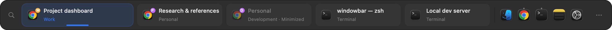
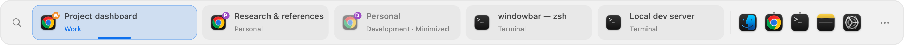
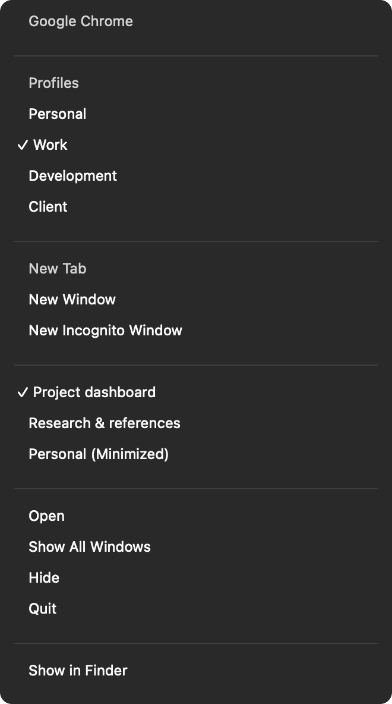
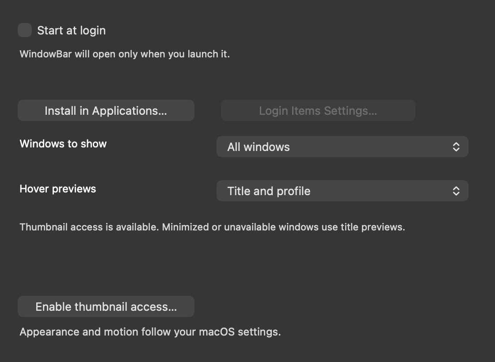
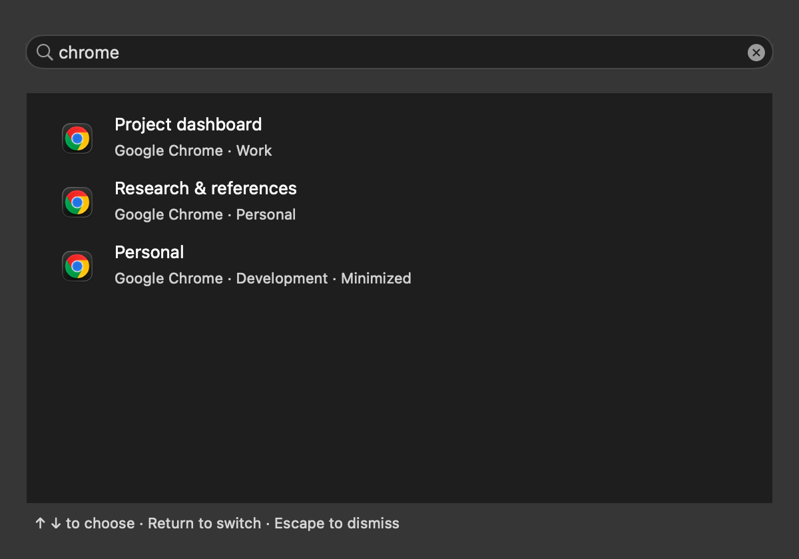
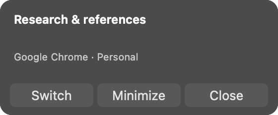
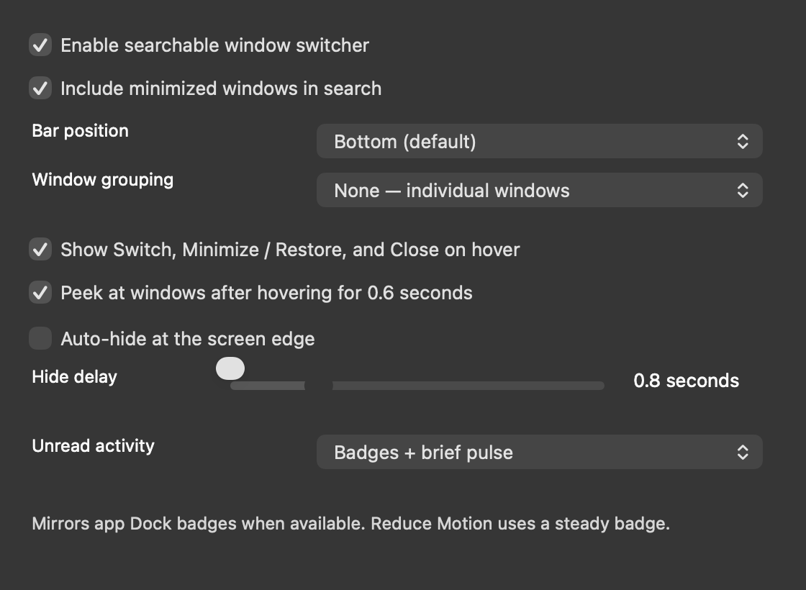

# WindowBar

A native macOS taskbar with **one button per window**. Keep Chrome and Terminal windows in a single row, identify Chrome profiles, and switch with one click.



## Features

- **Quiet Shelf:** system light/dark appearance, restrained focus styling, and pinned apps on the right. The leading “W” mark is removed.
- Window buttons shrink automatically, then scroll horizontally at their minimum size. The focused button is 30% wider; motion follows macOS Reduce Motion.
- **Drag to reorder** windows and pinned apps. Window order lasts for the current session; pinned app order persists across launches.
- **Pin and unpin apps** from window/launcher context menus or Settings → Pinned Apps. Existing Dock pins are imported once; managing WindowBar pins does not edit Dock pins.
- **Chrome profile badges:** show a name, initial, and consistent color when Chrome exposes its profile control. Right-click a window → Profile Badge to assign one manually or return to Automatic.
- **Every Chrome profile directly in its pinned-app menu.** Selecting one opens a new window in it. Native New Window/New Tab commands, window lists, Hide/Show, Quit, and Show in Finder remain available.
- **Display filtering:** show all windows or only windows on each bar's display. A spanning window belongs to the display containing its largest area. Windows without usable bounds remain reachable on every display.
- **Hover cards:** full title and profile by default; optional window thumbnails through ScreenCaptureKit. Missing permission, minimized windows, and ambiguous capture targets fall back to titles.
- **Searchable window switcher:** match title, app, and Chrome profile; use arrows and Return, double-click a result, or Escape to dismiss. The search button, menu action, and keyboard shortcut can be disabled; minimized results are optional.
- **Optional grouping:** app or app + Chrome profile. Click a header to collapse or expand; search still finds all windows, and keyboard selection expands its group. Collapse state lasts until the bar is rebuilt; grouping mode persists.
- **Hover actions:** Switch, Minimize / Restore, and Close from the nonactivating card. Actions can be disabled while retaining title/thumbnail previews.
- **Auto-hide:** optional bottom-edge reveal with a configurable 0.2–3 second delay. Menus, hover cards, settings, search, and dragging keep the shelf open. A small reveal strip stays within its own screen, including stacked displays. Reduce Motion disables fading.
- **Configurable global shortcuts** for search, next/previous window, and the first nine pinned apps. Registration conflicts retain the previous bindings. Shortcuts start disabled.
- **Start at login** from the installed app's Settings. Installation stages and verifies the app, and protects running installed copies from replacement.
- **Diagnostics:** bounded event logs, clean/unclean exit detection, export, and permission status. Logs omit window titles, profile names, URLs, and images.
- Optional bars on every display, and temporary Dock replacement with restoration on hide, quit, or force-quit.

## Screenshots and design

These images render the app's own offscreen AppKit views with sample titles/profiles. The menu image renders actual NSMenu item state with native labels and separators, without opening a popup or capturing the desktop.














[Interactive design study](docs/design/mockups.html) · [Design decisions](docs/design/README.md)

## Requirements

- macOS 14 Sonoma or later, on Apple silicon or Intel.
- Xcode Command Line Tools with Swift 5.10 or later. Use `xcode-select --install` if needed.
- Accessibility access for discovering and controlling windows.
- Screen Recording access only for optional thumbnails. Title previews do not need it.

No third-party packages or application network calls are used. Chrome launches locally; its metadata files are read-only.

## Build, install, and run

```sh
git clone https://github.com/SimeonLGeorgiev/windowbar.git
cd windowbar
# Until the window tools update is merged:
git checkout feature/window-tools
zsh build.sh
build/WindowBar.app/Contents/MacOS/WindowBar --install
open ~/Applications/WindowBar.app
```

The repository is private. The build creates an ad-hoc signed app for the current Mac's architecture. Installation copies it into your user Applications folder without launching it or replacing a running installed copy. The same action is available from Settings → General. Keep one copy running.

Grant **WindowBar** access in **System Settings → Privacy & Security → Accessibility**. Add the installed copy with **+** if needed. A rebuilt ad-hoc signed app can require granting access again.

Enable **Start at login** from the installed copy's Settings. If macOS reports that approval is required, use **Login Items Settings** to allow it. Login startup is not registered automatically during builds or tests.

Enable thumbnails in **Settings → General → Hover previews**, then use **Enable thumbnail access** if needed. Permission is requested only by this explicit button; hovering never opens a permission dialog. macOS may require reopening the app after granting access. Thumbnails stay in memory and are not logged or written to disk.

## Daily use

| Action | Result |
| --- | --- |
| Click a window button | Switch to that window; restore it if minimized |
| Drag a window button or pinned icon | Move it before/after another button of the same kind |
| Right-click a window | Switch, minimize/restore, close, pin its app, move, or choose a Chrome profile badge |
| Right-click a pinned app | Native app actions, its windows, move, or unpin |
| Right-click Chrome → profile | Open a new window in that profile |
| Hover a window | Full title/profile, optional thumbnail, and configurable window actions |
| Click the search icon | Search windows by title, app, and profile |
| Click a group header | Collapse or expand that app/profile group |
| Move to the bottom screen edge | Reveal the bar when auto-hide is enabled |
| Scroll over the windows or pins | Reach overflow items without a second row |
| **⋯** or menu bar icon → Settings | General, Behavior, Pinned Apps, Shortcuts, and Diagnostics |
| Settings → Shortcuts | Enable shortcuts and click a combination to record it; Escape cancels |

Default shortcuts are **Control–Command–Left/Right** for previous/next window and **Control–Command–1…9** for pinned apps. **Control–Command–Space** opens search. All global shortcuts remain inactive until enabled. Keyboard window navigation follows the selected display filter and reveals the selected button in the row.

**Settings → Behavior** configures search, minimized search results, grouping, hover actions, auto-hide, and hide delay. Grouping and auto-hide start off. Search and hover actions start on; title-only previews remain the default. Search covers windows from all displays even when each bar filters its row. If an existing customized shortcut uses the new search combination, it is preserved; choose a different search binding under Shortcuts.

**Show on all displays** controls where bars appear. **Settings → General → Windows to show** controls each bar's window list. Profile overrides and window ordering are session state; persistent pins and preferences are separate from Dock settings.

**Replace macOS Dock** is enabled once Accessibility is available. Hiding or quitting restores the saved settings. A separate guard restores them after a crash/force-quit. The backup at `~/Library/Application Support/WindowBar/dock-backup.plist` is retained if restoration fails.

## Development without interrupting a running copy

The builder refuses to overwrite a running app bundle. Build a separate candidate:

```sh
WINDOWBAR_APP_PATH="$PWD/build/candidate/WindowBar.app" \
WINDOWBAR_BUILD_PATH="$PWD/build/candidate-swiftpm" zsh build.sh
swift test --scratch-path build/candidate-swiftpm
zsh scripts/smoke.sh isolated
xcrun swift-format lint --strict --recursive Sources Tests Package.swift
```

The isolated checks exercise the daily-use features and all four window tools with temporary preferences/files, fake login/hotkey/capture backends, native controls and drag/drop callbacks, hover cancellation, and light/dark rendering. All windows stay offscreen; the wrapper verifies that the running taskbar PID, Dock snapshot, and Dock preferences remain intact. It does not activate Chrome/Terminal, register live shortcuts/login items, request permissions, or capture the desktop.

For a detached developer launch, use `python3 scripts/run.py`. It starts the built app in its own process session and redirects output to `~/Library/Logs/WindowBar/app.log`. For everyday use, open the installed app from Finder.

### Live desktop checks

These checks change focus or restart WindowBar. Run them when your desktop is available for testing, with Accessibility access and Chrome/Terminal open and pinned:

```sh
# WindowBar must be running:
zsh scripts/smoke.sh menus
zsh scripts/smoke.sh tabs
zsh scripts/smoke.sh terminal
# WindowBar must be closed:
zsh scripts/smoke.sh dock
zsh scripts/smoke.sh lifetime
```

Browser checks create isolated blank windows and close their own windows afterward. Terminal follows the current Accessibility handle as tabs change and closes its created window IDs. Lifecycle checks verify exact Dock restoration and survival after closing the launching process group. Failures return a nonzero status.

Actual login registration, real thumbnail capture, global shortcut delivery, physical monitor attach/detach, and auto-hide with physical pointer/Space transitions should also be checked on an installed copy when desktop testing is appropriate; isolated backend checks do not establish those OS integrations.

### Diagnostics and documentation

```sh
build/candidate/WindowBar.app/Contents/MacOS/WindowBar --diagnose
WINDOWBAR_APP_PATH="$PWD/build/candidate/WindowBar.app" zsh scripts/screenshots.sh
```

Diagnostics reports permission state and app window counts without titles. App events live in `~/Library/Logs/WindowBar/events.jsonl`, with one rotated archive. Each file rotates at approximately 512 KiB. Settings → Diagnostics can reveal or export events. Normal shutdown clears the session marker; a leftover marker from a dead process produces an unclean-exit event on the next launch.

Documentation rendering never opens menus or activates an app. Its fixed sample launchers/profile names do not contain accounts or desktop content. Chrome must be running for native New commands to appear in the menu rendering.

## Code organization

| Directory | Contents |
| --- | --- |
| `Sources/WindowBarCore` | Layout, ordering, display/capture matching, preferences, shortcut validation, profile decoding |
| `Sources/WindowBar/Services` | Accessibility, actions, menus, pin state, login, installation, hotkeys, previews, diagnostics, Dock lifecycle |
| `Sources/WindowBar/Views` | Native drawing, drag/drop, hover cards, settings, and shortcut recording |
| `Sources/WindowBar/Preview` | Sample fixtures, offscreen rendering, and isolated feature verification |
| `Tests/WindowBarCoreTests` | Pure XCTest cases |
| `Tests/Smoke` | Isolated and explicit desktop integration checks |

Read [architecture](docs/architecture.md) and [maintainability review](docs/code-review.md) before changing lifecycle or Dock handling. CI runs core tests, builds/verifies the bundle, and runs isolated native feature checks.

## Current limits

WindowBar overlays space rather than reserving it. Accessibility support and full-screen/Space behavior vary by app. Native New commands use English File/Shell headings. Chrome profiles use standard Chrome/Beta/Dev/Canary locations; custom user-data directories and localized/ambiguous profile controls may need a manual badge.

Unavailable or ambiguous windows get title-only previews. Monitor behavior is tested with simulated layouts; physical multi-monitor testing needs suitable hardware. This local build is ad-hoc signed and has no notarized release or update service. Build on each target architecture.
