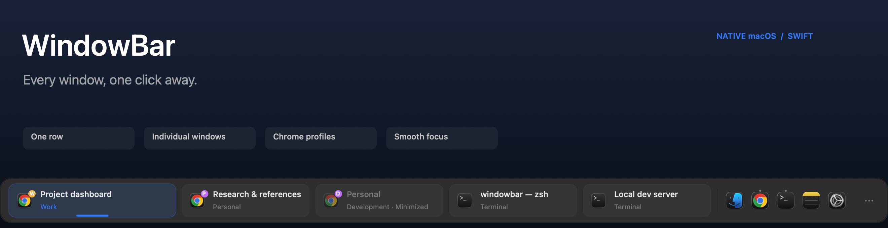

# WindowBar

A native macOS taskbar with one button per open window. Find and switch windows quickly, including Chrome windows from different profiles.

## Install

Download the [WindowBar.app.zip](https://github.com/SimeonLGeorgiev/windowbar/raw/refs/heads/main/downloads/WindowBar.app.zip) app bundle. It supports Apple silicon and Intel, so you do not need Xcode or Swift to install it.

Unzip the download, move `WindowBar.app` to **Applications**, and open it. If macOS warns that it cannot verify the developer, Control-click the app, choose **Open**, then confirm. This build is ad-hoc signed and is not notarized.

On first launch, allow WindowBar under **System Settings → Privacy & Security → Accessibility** so it can find and switch windows. Screen Recording access is optional; it enables thumbnails and full-size hover peeks. Turn on **Start at login** in WindowBar Settings if you want it to open when you sign in.

## Features

- **One button per window:** click to switch, drag to reorder, or scroll when the row fills.
- **Chrome profiles:** identify profile windows and open a new window from a profile menu.
- **Search and grouping:** find windows by title, app, or profile; group them by app or profile.
- **Hover previews:** see a thumbnail and window actions, or pause 0.6 seconds for a full-size peek.
- **Personalize the bar:** pin apps on either side, use multiple displays, enable auto-hide, shortcuts, or unread badges.
- **Desktop fit:** maximized windows stop above the taskbar so bottom controls stay accessible.
- **Optional Dock replacement:** off by default and restored when WindowBar quits.

See [daily use and settings](#daily-use), the [interactive design study](docs/design/classic-apple/mockups.html), or [architecture and development notes](docs/architecture.md).

## Daily use

Click a window button to switch to it. Right-click for window actions; right-click a pinned app for its menus. Select the search icon to find a window. Use **Settings** from the bar menu to manage pins, shortcuts, display behavior, and previews.
